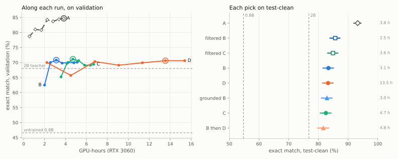

<div align="center">

# Distilling function calling without labels

**Qwen3.5-2B teaches Qwen3.5-0.8B to call tools, on one 12 GB GPU.**

[](https://joaomigueloliveira.github.io/qwen-function-calling-distillation/)
[](https://joaomigueloliveira.github.io/qwen-function-calling-distillation/results.html)
[](https://joaomigueloliveira.github.io/qwen-function-calling-distillation/decisions/)
[](docs/REPRODUCE.md)
[](https://forge.coreweave.com/wandb/joaomigueloliveira30/qwen-function-calling-distillation)

<a href="https://joaomigueloliveira.github.io/qwen-function-calling-distillation/"></a>

</div>

**Without a single label, fine-tuning Qwen3.5-0.8B on its 2B teacher's answers takes it from 54.8%
to 83.4% exact match on xLAM test-clean, past the teacher's 76.8%, in 3.1 GPU-hours on one RTX 3060:
74% of what training on gold labels gains, and the 0.8B serves 2.4× faster than the 2B.** Logit
distillation and on-policy distillation tie it on xLAM, at higher cost.

The question ([ADR 0007](docs/adr/0007-label-free-is-the-main-question.md)): distillation is what
you reach for when there are queries but no answers, and a model better than the one you want to
ship. Without labels, how close does the student get to one trained on gold answers, per GPU-hour?

## Findings

Each links to its section of [the essay](https://joaomigueloliveira.github.io/qwen-function-calling-distillation/)
and to the file in [`results/`](results/) behind it. Every comparison is a paired McNemar test,
Holm-adjusted over all 25 claims.

1. **Copying the teacher's answers is enough.** SFT on the 2B's own answers (B) beats the 2B on
   xLAM test-clean, 159 rows against 52 (Holm p < 0.0001).
   [Essay](https://joaomigueloliveira.github.io/qwen-function-calling-distillation/#copying-the-teachers-answers) ·
   [`methods.md`](results/methods.md)
2. **Soft targets and on-policy learning tie it on xLAM.** Logit distillation (C, 82.5%) and
   on-policy distillation (D, 83.3%) can't be separated from B, nor can grounded B (82.9%), B on a
   label-free filter of the teacher's answers. So the simplest is the headline.
   [Essay](https://joaomigueloliveira.github.io/qwen-function-calling-distillation/#the-label-free-methods-tie-so-the-simplest-is-the-headline) ·
   [`methods.md`](results/methods.md) · [ADR 0009](docs/adr/0009-selection-stays-methods-compared-on-test-clean.md)
3. **Labels still buy a lot.** The same recipe on gold answers (A) reaches 93.2%, partly by learning
   gold's quirks.
   [Essay](https://joaomigueloliveira.github.io/qwen-function-calling-distillation/#students-copy-the-teachers-habits-and-some-of-its-mistakes) ·
   [`methods.md`](results/methods.md)
4. **The student beats its teacher on xLAM, not on new tools.** On BFCL's unseen tools B stays below
   the 2B, 79.1% against 82.7%, though not after Holm.
   [Essay](https://joaomigueloliveira.github.io/qwen-function-calling-distillation/#the-student-beats-its-teacher-on-xlam-not-on-new-tools) ·
   [`methods.md`](results/methods.md)
5. **On unseen tools, the picks overstate the differences.** D leads B's selected checkpoint on
   BFCL (82.5% against 79.1%, Holm p = 0.009), and on xLAM under lenient exact (p = 0.03,
   unadjusted), at 4.3× the cost. But B keeps rising after its pick: with one seed, on-policy
   training can't be told from more training.
   [Essay](https://joaomigueloliveira.github.io/qwen-function-calling-distillation/#on-unseen-tools-the-picks-overstate-the-differences) ·
   [`methods.md`](results/methods.md)
6. **Students copy the teacher's habits, and some of its mistakes.** C fences 5.5% of its answers in
   a code block, as the 2B does; B repeats 64 of the 2B's 162 wrong
   BFCL answers that parse.
   [Essay](https://joaomigueloliveira.github.io/qwen-function-calling-distillation/#students-copy-the-teachers-habits-and-some-of-its-mistakes) ·
   [`methods.md`](results/methods.md)
7. **The gold labels needed an audit.** Of the 2,000 test rows, 88 have a wrong label and 287 an
   ambiguous one; methods are compared on the other 1,625, test-clean.
   [Essay](https://joaomigueloliveira.github.io/qwen-function-calling-distillation/#when-the-gold-answer-is-the-problem) ·
   [`label-audit.md`](results/label-audit.md)
8. **The student serves 2.4× faster** than its teacher one request at a time, and 1.9× cheaper
   batched, in vLLM on the same card: measured on the untrained 0.8B, which B adds a LoRA to.
   [Essay](https://joaomigueloliveira.github.io/qwen-function-calling-distillation/#the-student-serves-faster) ·
   [`serving.md`](results/serving.md)

## Results

Strict exact match, each method at the checkpoint validation chose. GPU-hours count everything on
the one card, the teacher's passes included. Intervals, every checkpoint and every paired test:
[`results/methods.md`](results/methods.md); baselines: [`results/baselines.md`](results/baselines.md).

| Model | Uses labels | GPU-h | Test-clean | BFCL |
|---|---|---:|---:|---:|
| Qwen3.5-0.8B, the student untrained | | 0 | 54.8 | 64.5 |
| Qwen3.5-2B, the teacher | | 0 | 76.8 | 82.7 |
| Qwen3.5-4B, for reference | | 0 | 81.8 | 82.7 |
| **B**: SFT on teacher outputs, the headline | no | 3.1 | **83.4** | 79.1 |
| **C**: logit distillation, teacher's top 20 | no | 4.7 | 82.5 | 81.6 |
| **D**: on-policy distillation | no | 13.5 | 83.3 | 82.5 |
| Grounded B: teacher outputs whose values are in the query | no | 3.0 | 82.9 | 79.8 |
| B then D: D's loss continued from B | no | 4.8 | 81.7 | 78.9 |
| Filtered B: teacher outputs that match gold | as a filter | 2.5 | 85.7 | 80.8 |
| Filtered C: C on the same rows | as a filter | 3.6 | 84.9 | 84.1 |
| **A**: SFT on gold labels, the reference | yes | 3.8 | 93.2 | 84.5 |

<picture>
  <source media="(prefers-color-scheme: dark)" srcset="docs/figures/cost-accuracy-dark.svg">
  
</picture>

*Left: validation at every checkpoint against GPU-hours; rings mark each run's pick. Right: each
pick on test-clean, with its 95% interval; hollow markers used labels.* Training curves on W&B: [A](https://forge.coreweave.com/wandb/joaomigueloliveira30/qwen-function-calling-distillation/runs/hmjki6iw) · [B](https://forge.coreweave.com/wandb/joaomigueloliveira30/qwen-function-calling-distillation/runs/z8e95dog) · [C](https://forge.coreweave.com/wandb/joaomigueloliveira30/qwen-function-calling-distillation/runs/0y6xmmx9) · [D](https://forge.coreweave.com/wandb/joaomigueloliveira30/qwen-function-calling-distillation/runs/9jf723fw) · [grounded B](https://forge.coreweave.com/wandb/joaomigueloliveira30/qwen-function-calling-distillation/runs/v1r4ks64) · [filtered B](https://forge.coreweave.com/wandb/joaomigueloliveira30/qwen-function-calling-distillation/runs/ejigjxko) · [filtered C](https://forge.coreweave.com/wandb/joaomigueloliveira30/qwen-function-calling-distillation/runs/sflzd7z6) · [B then D](https://forge.coreweave.com/wandb/joaomigueloliveira30/qwen-function-calling-distillation/runs/ra29h5ha).

## How it's measured

- **Task:** [xLAM-60k](https://huggingface.co/datasets/Salesforce/xlam-function-calling-60k),
  single-turn tool calls. Split into train (54,561), validation (1,000) and test (2,000), grouped
  so no query is in two splits ([dataset card](docs/DATASET.md)).
- **Score:** strict exact match by rule, no LLM judge; lenient exact beside it, for optional
  arguments at their default ([every metric and slice](docs/notes/details.md#task)).
- **Test-clean:** test without the labels the audit found wrong or ambiguous. Test itself is never
  edited ([ADR 0002](docs/adr/0002-test-labels-never-edited.md)).
- **BFCL:** 1,000 non-live single-turn rows, tools the student never saw ([notes](docs/bfcl.md)).
- **Selection:** checkpoints are chosen on validation; test is run once, on the pick.

## Limitations

- One seed and one untuned LoRA setup per method ([ADR 0006](docs/adr/0006-shared-training-setup.md)).
- One small teacher; the results are about this pair, on this task
  ([ADR 0004](docs/adr/0004-student-teacher-pair.md)).
- "Label-free" is about training only: checkpoints are chosen on labelled validation.
- Next: GRPO, a reward checked against gold, as a stretch goal
  ([ADR 0007](docs/adr/0007-label-free-is-the-main-question.md)).

Every finding with its counts, and the limitations in full: [`docs/notes/details.md`](docs/notes/details.md).

## Reproduce it

Requires [uv](https://docs.astral.sh/uv/), an NVIDIA GPU, and access to the gated dataset (accept
its terms on the Hub, then `uv run hf auth login`).

```bash
uv sync --extra inference --extra train --group site   # vLLM, the trainers and Quarto
uv run --no-sync fc-eval --model Qwen/Qwen3.5-0.8B --split test-clean   # any model or adapter
uv run --no-sync fc-sft --targets teacher --teacher-run runs/eval-train-Qwen_Qwen3.5-2B \
  --group-by-length --save-steps 500                   # method B, after the teacher's pass
uv run --no-sync fc-report --methods                   # results/methods.{json,md} from the runs
uv run --no-sync quarto preview site                   # the essay
```

**[`docs/REPRODUCE.md`](docs/REPRODUCE.md)** has every experiment's commands in order, from the
split and the baselines through each method's training and checkpoint evals to serving and the
site, and the repository structure module by module. Development needs no GPU: `uv sync` (which
drops the GPU extras), `uv run pytest`, `uv run pre-commit run --all-files`.

## Layout

```
src/fc_distill/   one module per step: data and splits, the scorer, fc-eval, the methods
                  (fc-sft, fc-opd, fc-teacher-topk), reports and figures, serving
site/             the essay (Quarto), built from results/ and data/
results/          results worth keeping: baselines, methods, label audit, serving, examples
docs/             REPRODUCE.md, dataset card, ADRs, notes, figures
data/             committed split ids, the audit labels, the measured token probes
```

## License

Apache-2.0. Qwen3.5 models are Apache-2.0; the xLAM dataset is CC-BY-4.0.
